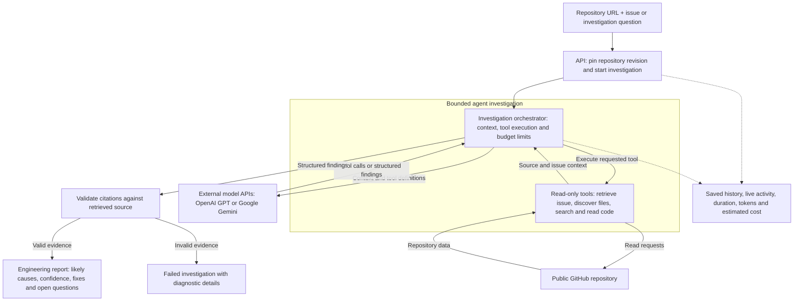

# RepoSleuth AI

AI agent for investigating GitHub issues and code, with evidence-backed engineering reports.

The agent independently selects tools, searches public repositories, reads source
files, and gathers evidence to explain likely root causes and recommend fixes.
Investigations are read-only: the agent does not modify code or execute repository
commands. Run it on your computer, in Docker, or on a cloud server.

Includes the
investigation workspace, durable API, 20-case evaluation corpus, credential-free
regression suite, Docker demo, and GitHub Actions checks. Real-model accuracy and
latency targets remain unverified pending API credits and independent review.
See [the implementation plan](IMPLEMENTATION_PLAN.md) for development history and acceptance checks.

For real GitHub/model evaluation, see [the three public benchmark projects](docs/public-benchmarks.md):
Node.js/TypeScript, C#/.NET, and React/TypeScript, with five issue investigations each.
These are separate from the prewritten demo and scripted replay corpus.

## How it works

See the [model communication sequence and file-discovery walkthrough](docs/architecture.md#how-reposleuth-and-the-model-communicate)
for who does what, how tool requests travel between the model and RepoSleuth, and
how the model discovers which source lines to read and cite.



The orchestrator calls the selected external model for reasoning and tool selection,
then executes the requested tools and returns their results to the model.
The agent repeats tool calls as needed within configured turn, tool, time, token,
and cost limits. Reports cite file paths and line ranges from the pinned revision.
Citation validation checks source support; root-cause conclusions remain hypotheses
for engineers to review.

The agent reserves capacity for reporting before continuing exploration. As request,
tool, token, cost, context, or time limits approach, it disables further tools and asks
for a partial report using the evidence already collected. Activity shows the reason;
the saved report lists the remaining coverage gaps. Source citations still pass the
same validation. Final requests remain inside the original limits—provider errors,
cancellation, slow requests, or a budget too small for even one response can still
prevent a report. No extra budget or automatic retry is added.

Reserve planning estimates the final request with tools removed and adapts the next
tool-result allowance to the remaining cost, token and context capacity. Results that
exceed that allowance are withheld without issuing evidence handles; the agent can
narrow the read. If less than 1 KiB remains for a useful tool result, it reports from
existing evidence. This avoids reserving a large hypothetical transcript before any
source has been examined, while retaining hard admission checks on every model call.

Stopped investigations show the specific error, relevant configured limit, last
recorded tool or reporting step, and source ranges read at the pinned commit.
The same diagnostics are available when reopening history. Partial reports show
why exploration ended; rejected output is never presented as an accepted report.
Older runs without source-read events explicitly indicate that details are unavailable.

## Requirements

- Node.js 22.13+, 24.x, or 26+ and npm (Node 24 LTS recommended).
- Network access to npm for installing dependencies.
- No GitHub or LLM credentials required for tests, replay evaluation, or the demo.

## Run locally

From this workspace:

```sh
npm install
npm run dev
```

Open http://127.0.0.1:5173. The API binds to http://127.0.0.1:3001 and the UI proxies
`/api` to it. Both services bind only to loopback. Stop them with Ctrl+C.

Root `.env.local` is loaded only by the backend. If it does not exist, copy
`.env.example` to `.env.local` and edit it locally. Never overwrite an existing
credential file. Never prefix secrets with `VITE_` or commit env files. The Vite
configuration reads only PORT from the root environment for its development proxy.
Health responses contain no configuration values or secrets.

### Choose OpenAI or Gemini

Set `LLM_PROVIDER=openai` (the default) with `OPENAI_API_KEY`, or set
`LLM_PROVIDER=gemini` with `GEMINI_API_KEY` in the root `.env.local`, then restart
the API. Gemini uses `gemini-3.5-flash-lite`; OpenAI keeps `gpt-6-luna`.
`LLM_PROVIDER` sets the default provider. In the investigation form, choose
the automatically loaded model dropdown, grouped under OpenAI or Google Gemini.
Both providers are available when both server keys are configured. The selection
applies to that investigation; saved reports keep their original provider and model.
CLI smoke checks and evaluations continue to use the server default.
There is no automatic fallback to another provider or key.

Get a Gemini key from [Google AI Studio](https://aistudio.google.com/apikey) and
save it directly in the local env file. Keys stay on the backend. Gemini uses
[Google's OpenAI-compatible endpoint](https://ai.google.dev/gemini-api/docs/openai)
with the same read-only tools, evidence validation, cancellation, and budget limits.
For text requests, estimates use standard paid rates of $0.30 per million input
tokens and $2.50 per million output tokens, even on the free tier. These are
conservative estimates, not invoices; free-tier availability and limits depend on
Google's account rules. [Gemini pricing](https://ai.google.dev/gemini-api/docs/pricing)
(checked October 24, 2026).

## Investigation depth

Successful source reads return evidence handles. The model selects a handle and a
contained line range; the backend constructs the exact quote, path, and pinned
commit. Citation validation still checks references and ranges. Valid citations
do not by themselves establish a correct diagnosis.

Saved benchmark attempts can be checked without model calls using
`npm run benchmark:grade`. See [automated grading](docs/public-benchmarks.md#automated-grading)
for optional AI scoring, privacy boundaries, and spending limits.

Choose a mode before starting; Standard remains the default for older clients and saved runs.

| Mode     | Time limit | Estimated cost limit | Model requests | Tool calls | Token limit |
| -------- | ---------- | -------------------- | -------------- | ---------- | ----------- |
| Quick    | 1 minute   | $0.02                | 6              | 10         | 50,000      |
| Standard | 2 minutes  | $0.05                | 12             | 24         | 100,000     |
| Deep     | 5 minutes  | $0.15                | 24             | 48         | 300,000     |

Quick follows the most likely path. Standard checks the relevant path and an alternative
explanation. Deep asks the model to inspect related callers, callees, safeguards and tests,
compare competing causes, and actively look for counter-evidence. All modes retain the same
2,000-token per-response cap: depth allocates more investigation capacity, not longer answers.
Coverage depends on available source and remaining budget; missing checks must be disclosed.

New reports include an evidence-based reasoning summary with cited assessments, alternatives,
counter-evidence and limitations, also included in Markdown exports. References are validated
against source read during the run; this verifies citations, not the correctness of a hypothesis.
Older reports remain readable without manufacturing a reasoning summary.

Limits apply to an active run (queue time excluded). Conservative request reservations,
token/context limits and the persistent server budget can stop work earlier. Cost caps use
configured pricing estimates, not provider billing guarantees. Mode selection never launches
a request by itself; starting an investigation still requires submission.

## Verify

```sh
npm run check
```

This runs formatting checks, TypeScript checks, ESLint, Vitest API and React interaction tests, and
production builds. Tests need no external APIs or paid calls.

See [code structure and testing](docs/code-structure.md) for the directory layout,
test placement, file-comment conventions, and focused verification commands.

## Investigation history and search

Choose **Investigation history** in the header to browse saved runs, newest first.
Search questions, report summaries, finding titles/explanations, and evidence file
paths. Search uses SQLite FTS5: all entered words must match; punctuation separates
words, and operators such as `OR` are treated as ordinary words.

Combine search with an exact repository (GitHub URL or `owner/repo`), issue number,
model name, and status. Results show 20 runs per page. **Open report** restores the
saved investigation without making a new model request; failed or unfinished runs
offer **View investigation**. Click **Search** again for current statuses.

**Export Markdown** downloads a validated report with its question, findings,
confidence, uncertainty, evidence excerpts, commit references, proposed fixes,
verification plan, risks, open questions, and usage. Runs without a report cannot
be exported. History and exports work without a configured model API key. Demo
cases are illustrative fixtures and are not inserted into saved history.

Existing saved runs are indexed automatically on startup, and updates keep the
index synchronized. History belongs to this server's SQLite database. The current
app has no user accounts: repository filters are not access controls. Before a
shared cloud deployment, authentication and server-derived owner scoping must cover
listing/search (including counts), reopening, exports, events, and cancellation.
See [history storage and access design](docs/investigation-history.md).

## Investigation workspace

1. Open http://127.0.0.1:5173 and enter a public GitHub URL or `owner/repository`.
2. Optionally enter an issue number, then describe what to investigate.
3. Select **Investigate** to start a bounded, billable API run. Watch the activity
   timeline, elapsed duration, input/output tokens, and estimated cost. **Stop
   investigation** requests cancellation; already submitted requests may incur cost.
4. Review the report, expand source evidence, and use immutable GitHub links to
   inspect the cited commit. Suggestions and test plans have not been executed.

The URL stores the investigation ID, so refreshing or reopening that URL restores
the persisted result on the same local server. SSE reconnects replay events and
status polling provides a fallback. Closing the tab does not cancel work.
Quota, budget, cancellation, timeout, and interrupted states are displayed explicitly.
Missing token usage is labeled incomplete with the reserved amount shown.
New runs distinguish request, tool, context, token, and cost limits. Pre-request
checks include a conservative allowance for the next call, so a run may stop below
the displayed usage totals. Give a concrete issue or symptom: a generic repository
request is instructed to do only brief discovery and ask for missing details in its
report rather than attempt an unrestricted audit.

Choose **Show demo investigation**, or open http://127.0.0.1:5173/?investigation=demo,
to browse all 20 synthetic cases using the **Explore the 20 defect cases** selector.
Use the left/right arrow buttons beside the dropdown to move between cases.
The URL preserves the selected case on refresh. Each case shows source, expected
cause, proposed fix, and verification without API calls. Demo paths and commit IDs are
illustrative and deliberately have no external source links. Source and report
text is rendered as escaped React text; credentials remain on the server.

Demo duration, token counts, requests, and estimated costs are fictional fixture
values, not actual API usage. Cases include distinct risks and open questions,
proposed code with explanations, and numbered source evidence. Some cases cite
multiple excerpts. The demo banners remain visible to distinguish these examples
from live reports.

Demo mode highlights the selected button and disables the live form. Choose
**Start a real investigation** to leave the demo and restore your editable draft.

`npm run build` creates each application's `dist/`. Run the compiled backend with
`npm start -w @reposleuth/api`. Production UI hosting and Docker integration are
available below; use `npm run dev` for development.

## Docker demo (no credentials or paid calls)

With Docker Desktop running:

```sh
docker compose up --build -d --wait
npm run smoke:deployment
```

Open http://127.0.0.1:5174/?investigation=demo. The image runs types, lint, the test suite,
production builds, and all 20 scripted evaluation cases during its build. Fastify
serves the built UI and API together. The default image sets `DEMO_ONLY=1`, so live
investigations are disabled even if a key is accidentally supplied. Environment
files are excluded from the image. SQLite storage uses a named volume; the image
runs as a non-root user with a read-only filesystem. Stop with `docker compose down`;
the volume is retained. Do not use `down -v` unless you intend to delete stored runs
and budget history.

To explicitly enable live investigations, supply `LLM_PROVIDER` and the matching
`OPENAI_API_KEY` or `GEMINI_API_KEY` in your shell
environment and run:

```sh
docker compose -f compose.yaml -f compose.live.yaml up -d --wait
```

Optional `GITHUB_TOKEN` and `APP_BUDGET_USD` are passed at runtime by this override.
Do not paste credentials into commands, source, or the Dockerfile. The container's
ledger is separate from the local development database. Ports are published only
on loopback; keep this local application off public interfaces.

## Evaluation and CI

```sh
npm run eval
```

The 20 synthetic cases cover N+1 queries, stale state, missing await, cache
invalidation, races, and pagination. Replay results are written to
`data/evals/latest.json`. This exercises the actual SDK loop with scripted answers;
it does not measure model reasoning accuracy. No API calls are made.

See [evaluation instructions and human grading](docs/evaluation.md) for the opt-in,
budget-capped live evaluator and accuracy rubric, and [architecture](docs/architecture.md)
for data flow and operating boundaries. GitHub Actions runs checks, replay, Docker
build/health, and deployment smoke without secrets on PRs and pushes to `main`.
The workflow must run on GitHub after publication before remote CI is confirmed.

## Layout

```text
apps/api/          Fastify backend and integration tests
apps/web/          React/Vite frontend
packages/shared/  Shared runtime schemas and TypeScript types
```

## Inspect a public repository

```sh
npm run inspect -w @reposleuth/api -- octocat/Hello-World
npm run inspect -w @reposleuth/api -- owner/repo 42
```

The second form retrieves issue 42 and its first 20 comments. A pull request number
is rejected. A GitHub HTTPS repository URL is also accepted. Public repositories
work without a token, subject to GitHub's unauthenticated rate limit. Optional
`GITHUB_TOKEN` belongs only in root `.env.local`; use read-only contents/issues
permissions. This CLI never uses the OpenAI key.

The `RepositoryProvider` interface exposes `getIssue`, `listFiles`, `searchCode`,
`readFile`, `getCommits`, and `getFileDiff`. Instantiate `OctokitProvider.connect`
once per investigation. It resolves the default branch once, pins the commit and
tree SHAs, and reads blobs from that tree. History is anchored to the same commit.
Diffs accept only commits returned by `getCommits` for the requested path. The
provider makes GET requests only and never clones or executes repository code.

Issues/comments are live metadata with a retrieval timestamp, not historical
content pinned to a source commit. Diffs are historical context; use `readFile`
for exact source evidence. Line numbers are one-based. Reads clamp the end at EOF
and reject a start beyond EOF, including empty files.

Limits per provider instance:

| Resource                               | Limit                                                                     |
| -------------------------------------- | ------------------------------------------------------------------------- |
| Eligible tree entries / returned paths | 5,000 / 500                                                               |
| Individual source file                 | 128 KiB, UTF-8 only                                                       |
| Search index                           | First 40 eligible paths in sorted order, at most 2 MiB                    |
| Search                                 | Literal, case-sensitive, 2–200 characters; 30 matching lines              |
| Source read                            | 200 lines and 24,000 characters                                           |
| Issue comments / field text            | 20 / 8,000 characters                                                     |
| File history / diff pagination         | 10 commits / 300 changed files                                            |
| Network                                | 2 setup requests + up to 55 operation requests; 15-second request timeout |

Search indexes are in memory and cached per instance. Binary files, symlinks,
submodules, dependency/build directories, env files, lockfiles, and common binary
extensions are excluded. Truncation and exclusions are returned as explicit warnings;
an empty search is not proof a symbol is absent from the repository. GitHub-truncated
trees are not expanded with unbounded follow-up requests. API failures use sanitized
error codes, including rate-limit/access denial and exhausted request budget.

The GitHub integration uses mocked HTTP fixtures for all six operations and error/boundary cases.
A live unauthenticated smoke check also exercised discovery, reading, search,
history, and diffs on `octocat/Hello-World` at commit
`7fd1a60b01f91b314f59955a4e4d4e80d8edf11d`. Live checks are not part of `npm test`.

## Cost and safety

The agent never executes shell commands, modifies repository files, or creates PRs.
Evidence validation checks the SHA, path, inclusive line range, exact quote, and
finding references against source actually read in that run. This verifies citation
integrity, not the correctness of a root-cause hypothesis. Confidence is qualitative.
Tests are proposed, never executed by the agent. Repository content remains untrusted.

## Run an investigation via the API

Select a provider and save its key in root `.env.local` (see above), then run `npm run dev`. The backend
loads the key server-side only. Starting the server or checking health costs nothing;
submitting an investigation makes paid API requests. Without a key, POST returns 503.

PowerShell example using a small public repository:

```powershell
$body = @{
  repository = 'octocat/Hello-World'
  question = 'Inspect the repository and explain whether there is enough source code to investigate a defect. Do not invent a defect.'
} | ConvertTo-Json
$run = Invoke-RestMethod -Method Post -Uri 'http://127.0.0.1:3001/api/investigations' -ContentType 'application/json' -Body $body
Invoke-RestMethod "http://127.0.0.1:3001/api/investigations/$($run.id)"
```

For an issue investigation, add `issueNumber` with a real issue number in that public
repository. `owner/repo` and `42` in architectural examples are placeholders.

| Endpoint                              | Behavior                                                                                  |
| ------------------------------------- | ----------------------------------------------------------------------------------------- |
| POST `/api/investigations`            | Validate input and return 202 with queued run ID                                          |
| GET `/api/investigations`             | Paginated history; `q`, `repository`, `issueNumber`, `model`, `status`, `limit`, `offset` |
| GET `/api/investigations/:id`         | Status, report, revision, duration, token usage, estimated cost                           |
| GET `/api/investigations/:id/export`  | Markdown attachment; 409 when no validated report exists                                  |
| GET `/api/investigations/:id/events`  | SSE progress; reconnect with Last-Event-ID or `?after=ID`                                 |
| POST `/api/investigations/:id/cancel` | Cancel queued/running work                                                                |
| GET `/api/health`                     | Service health; does not verify API access or balance                                     |

SSE emits queued, started, revision, tool_started, tool_finished, usage, validating,
and terminal events. These contain tool names/outcomes, not raw tool inputs, source,
model reasoning, or upstream errors. Disconnecting SSE does not cancel a run. Streams
close on terminal state; slow consumers reconnect using their last received event ID.

One investigation runs at a time, with at most five queued/running runs. Terminal
states are completed, failed, budget_exceeded, cancelled, timed_out, and interrupted.
On restart, unfinished runs become interrupted rather than silently rerunning paid work.
Data lives in ignored `data/investigations.sqlite`. Run only one backend process per
database. Local API access is unauthenticated: use only on a trusted machine. The
server binds loopback and rejects nonlocal Host and unapproved browser Origin headers.

### Budgets and model

The default model is `gpt-6-luna` with low reasoning effort, standard processing,
remote tracing disabled, response storage disabled, and automatic model retries disabled.
Public source excerpts and the investigation question are sent to the selected provider for inference.
Gemini uses Flash-Lite with minimal thinking; remote tracing and automatic retries remain disabled.
Model discovery lists models returned by configured provider accounts. Discovery
does not establish tool compatibility or prices. Only models with a reviewed
server profile can be selected; unknown models remain visible but disabled.
The existing OpenAI and Gemini defaults have built-in profiles. To enable another
discovered model, verify that it supports the current agent adapter (tool calls,
structured report output, and reasoning settings) and add its standard token rates
to `MODEL_PROFILES_JSON` in the server environment, then restart:

```text
MODEL_PROFILES_JSON=[{"provider":"openai","model":"YOUR_REVIEWED_MODEL_ID","inputPerMillion":1,"outputPerMillion":2}]
```

The numbers above are illustrative, not prices for any model. Profiles can override
the default rates. Unlisted models, missing keys, and failed discovery are rejected
before queueing; there is no silent model fallback. Lists are cached for five minutes
(30 seconds after provider errors). Discovery uses metadata requests only, never
paid inference probes. Keys and upstream error details remain on the server.
See the [OpenAI model-list API](https://developers.openai.com/api/reference/resources/models/methods/list)
and [Gemini model-list API](https://ai.google.dev/api/models#method:-models.list).

Per run: 12 model requests, 24 tool calls, 100,000 total reported tokens, 2,000 output
tokens per request, 80,000 estimated input tokens per request, a 120-second deadline,
and a US$0.05 estimated cost ceiling. A timed-out model request may still have incurred
charges. In-flight GitHub requests may finish after cancellation, but no further model
request or report publication is allowed for that run.

Before each call, the app estimates input tokens conservatively from serialized UTF-8
bytes plus overhead and reserves that cost plus the maximum output allowance. This is
an application safeguard, not an exact tokenizer or billing guarantee. Reported token
usage is accumulated after responses; missing usage leaves `usageIncomplete: true`
and a nonzero `reservedCostUsd`. `estimatedCostUsd` uses recorded token counts at
conservative rates and is not an invoice amount.

OpenAI rates checked 2026-10-22: standard input US$0.10, cache writes US$0.125, output US$0.50
per million tokens. Budget calculations price all input at US$0.125 to allow for cache
writes. See [official model pricing](https://developers.openai.com/api/docs/models/gpt-6-luna).

`APP_BUDGET_USD` defaults to US$1 and supports values above zero up to US$5. The SQLite
ledger reserves cost atomically and never refunds reservations, even on success. It
therefore stops conservatively, persists across restarts, and is separate from your
provider account balance. Deleting the database removes this safeguard's history. Keep
auto-reload disabled in your billing settings if you do not want automatic purchases.

### Verification

`npm run check` uses a deterministic fake model through the real Agents SDK loop and
makes no paid calls. It covers citation rejection, usage aggregation, budget failures,
cancellation, timeout, restart recovery, SSE replay, and local API access checks.

An explicit opt-in live smoke test uses synthetic source and the real model:

```sh
npm run smoke:agent -w @reposleuth/api -- --live
```

This test has a US$0.02 estimated per-run ceiling and a separate persistent US$0.05
reservation ledger in `data/live-smoke.sqlite`. It prints only run status and usage;
inspect the database for the persisted report. It does not access or modify GitHub.

Live checks have produced validated reports with GPT-5.4 mini and Gemini. Automated
benchmark grades are not proof that proposed fixes work; no repository tests are
executed. Quota failures are classified as `OPENAI_QUOTA`, distinct from rate limits.
Failed requests retain their reservations; zero reported tokens do not establish a
zero invoice charge.

Token admission uses a local o200k_base tokenizer for GPT-5 names, with a 30% margin
and 2,048 tokens for framing. Other model families retain the UTF-8 byte estimate.
These are padded estimates, not exact provider counts or billing guarantees. Actual
usage is recorded after each response; an underestimated input stops further calls.
The issue fetched during preflight is included as untrusted input to avoid a redundant
lookup. Search guidance favors reading a discovered path before another search.

`find_files` searches filenames and paths case-insensitively within a bounded
tree of up to 5,000 eligible paths, returning at most 40 matches after filtering
by scope and query and preserving truncation warnings. No source blobs are
downloaded for filename discovery. Both `find_files` and
`search_code` accept a model-selected `scope`, such as `packages/solid-query`;
empty or omitted scope searches from the root. File/byte limits apply after scope
filtering, while total GitHub requests and source-cache limits stay shared.
`list_files` accepts an empty prefix, `.` or
`./` for the repository root. The agent is instructed to follow referenced class names
to their implementation before reporting a cause.
