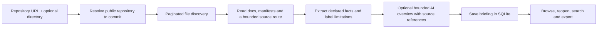

# RepoSleuth AI

Source-linked onboarding briefings for public GitHub repositories.

Enter a repository URL to discover its structure, read its documentation, inspect declared setup commands and dependencies, and get a suggested reading order. Every briefing is pinned to a commit and can be reopened, searched, and exported as Markdown.

When requested and accepted, the briefing opens with a readable AI overview of the project's purpose, organization and suggested starting points. Source links accompany each section. Expand the details to inspect the underlying inventory, scripts, dependencies and documentation. The inventory is extracted deterministically; the AI overview is an interpretation of those sources, not verified runtime behavior. Repository commands are never executed.

## Start

Requires Node.js 22.13+, 24.x, or 26+ and npm.

```sh
npm install
npm run dev
```

Open http://localhost:5173/. The API listens on port 3001.

Configure an OpenAI or Gemini key and an enabled model for the AI overview. Each overview makes one request, capped at $0.03 estimated usage and the existing persistent application budget. Disable **Include a readable AI overview** for source facts only, with no model calls. Model errors preserve the factual briefing and are shown explicitly. An optional server-side `GITHUB_TOKEN` in `.env.local` improves GitHub rate limits. Keep `.env.local` out of Git. Set `DEMO_ONLY=0` or leave it unset to permit public-repository reads.

1. Enter `https://github.com/owner/repository` or `owner/repository`.
2. Optionally enter a repository-relative directory such as `packages/web`.
3. Select **Generate briefing**.
4. Read the overview, map, declared scripts, documentation excerpts, reading order, tests and limitations.
5. Select a discovered package to fill the form; generation still requires an explicit click.

Briefing history is closed by default and paginated five entries at a time. Search by repository or directory. Opening one restores the original inputs without starting a new request. Markdown exports preserve the overview and pinned source links.

## How onboarding works



The model receives documentation excerpts, extracted declarations and up to six connected source excerpts. When available, **How this project works** explains a sampled route with line-linked steps and reading tips. Expand its coverage section to inspect the actual excerpts. Summary source references must point to retrieved files; walkthrough citations must fit inside retrieved line ranges and use at least two files reachable through the sampled static references. This validates source identity, not the semantic correctness of every explanation. Facts and explanations remain visually separate.

## What is supported

- Public GitHub repositories and directory-scoped briefings.
- Languages inferred from file extensions; counts describe eligible discovered files.
- Directory maps, documentation excerpts and filename-based test locations.
- `package.json` descriptions, scripts, dependencies, development dependencies, engine requirements, package-manager declarations and entry targets.
- Source links pinned to the inspected revision.
- Persistent jobs and history in `data/briefings.sqlite`, separate from archived investigations.

Limits are visible in each report. Discovery is bounded to ten pages (up to 5,000 eligible paths); at most two documentation files and eight package manifests are read, with 24 total source reads (six reserved for code) and a two-minute repository-reading deadline. Code excerpts are limited to the first 120 lines and 2,400 characters per file, preserving whole lines. The GitHub provider also filters generated, oversized and unsupported files. Incomplete or malformed manifests are not used to generate facts.

Non-JavaScript projects still get a file map and documentation links. Other ecosystem manifests, such as `.csproj` and `pyproject.toml`, are identified but **not parsed into setup commands or dependencies yet**. TypeScript/JavaScript relative imports are parsed as static dependencies. C# references are explicitly labeled lexical type-name candidates; namespaces, overloads and dependency injection are not resolved. Ambiguous filenames are not followed. Aliases, dynamic imports and external dependencies are not resolved. A dependency declaration does not establish runtime usage. Reading order is a suggestion, not a verified call graph.

## Docker

The existing image defaults to demonstration-only mode. To enable public-repository onboarding:

```sh
docker compose -f compose.yaml -f compose.live.yaml up --build
```

Open http://localhost:5174/. Supply model credentials and an optional `GITHUB_TOKEN` through the host environment, or disable the AI overview to use source facts without model keys. Credentials are runtime configuration, not baked into the image. SQLite data persists in the Compose volume.

The server retains its existing loopback host/origin restrictions. Public shared deployment and authentication are not implemented.

## Current status and known limitations

Onboarding is the primary workflow. It provides saved source inventories and optional AI explanations; a successful model response is not proof that every statement or command is correct. Use **Declared setup** and linked repository documentation for exact commands. A rejected optional walkthrough leaves a valid overview available; rejected overviews show their reason and preserve source details. No automatic retry is made by onboarding.

Source retrieval and local validation are tested. Live evaluation produced mixed walkthrough results, including a wrong in-range citation. The latest `web-image-audit` verification generated a readable overview but paraphrased an npm command incorrectly and omitted the walkthrough. Treat **How this project works** and the investigation workspace as experimental. There is no promise of reliable autonomous diagnosis or verified runtime behavior.

See the [project handoff](docs/project-handoff.md) for the final state, verification, limitations and restart instructions. Evaluation artifacts, saved runs and credentials remain local and are excluded from Git.

## Development

```sh
npm run check
```

Onboarding code lives in `apps/api/src/onboarding`, `apps/web/src/features/onboarding`, and `packages/shared/src/briefing.ts`. Tests live in each app's dedicated `tests` directory.

## Investigating (experimental)

Use the top-level **Onboarding** and **Investigating (experimental)** tabs to switch workflows. Existing `?investigation=...` links, history, demos, API routes, benchmark artifacts and provider settings are preserved. Experimental investigations and optional onboarding overviews can incur configured model charges. Switching tabs does not start a request.

Reliable autonomous diagnosis was not demonstrated on unfamiliar repositories. Completed output and valid source quotes do not prove that an explanation is correct. Guided and fixed-retrieval research workflows are retained for reproducibility and require explicit programmatic/CLI opt-in; they are not the default application workflow or validated product improvements.

Historical technical documentation: [architecture](docs/architecture.md), [reliability results](docs/investigation-reliability.md), and [public benchmark projects](docs/public-benchmarks.md).
