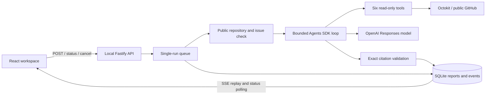

# Architecture and operating boundaries

The application owns the SDK loop; the model chooses tools within a fixed allowlist.
The source repository is never cloned, mounted, or executed. Tool calls only retrieve
issues, source, history, and diffs. Proposed fixes are report text, not patches.
The app writes its own SQLite state and evaluation output, not the investigated repo.

Repository connection verifies public visibility and pins the source commit. Issue
metadata is live; the supplied issue number is checked before any model request.
All retrieved text is untrusted. Citations must match exact lines actually returned
by `read_file` in that run. Citation validity does not establish causal correctness.
The frontend renders text with React escaping and constructs commit-pinned links.

The service runs one investigation at a time and queues up to five. It records
progress and usage in SQLite. The browser reconnects SSE with its event cursor and
polls status every 2.5 seconds as a fallback. Refresh uses the run ID in the URL;
closing a tab does not stop server work. Cancellation/timeout fences prevent late
callbacks from publishing results. Restart marks unfinished work interrupted.

Default model limits: 12 turns, 24 tool calls, 100,000 reported tokens, 2,000 output
tokens/request, 120 seconds, and $0.05 estimated cost/run. Provider limits and input
estimation are described in the README. Before model calls, a persistent ledger
reserves a conservative bound. Reservations are not refunded and are not invoices.
Incomplete usage remains labeled. OpenAI retries are disabled; GitHub rate-limit
failures are surfaced without automatic retries. A user may explicitly start a new
run after addressing the cause; it has a new budget reservation.

Development uses Vite on loopback:5173 with a proxy to Fastify on loopback:3001.
Production serves only the built web directory alongside the API. Host/Origin
checks remain in force. Docker binds internally on 0.0.0.0 but Compose publishes
only 127.0.0.1:5174. It runs as a non-root user with a read-only root filesystem,
no Linux capabilities, a writable data volume, and a small temporary filesystem.
There is no remote authentication; do not expose this local service publicly.

`DEMO_ONLY=1` disables live investigations even if credentials are present. The
default Docker image enables it. The live Compose override explicitly disables it
and passes secrets only at runtime. `.dockerignore` excludes all environment files,
SQLite databases, logs, and local dependencies from the build context. No repository
write, shell, PR, Kubernetes, vector database, or multi-agent tool is available.

The replay evaluator uses the same service, SDK, tools, storage, budgets, and
validator with synthetic repositories and scripted model responses. It measures
pipeline correctness. Optional live evaluation uses only fixture source/questions;
expected root causes are kept in the evaluator, outside the model context.
