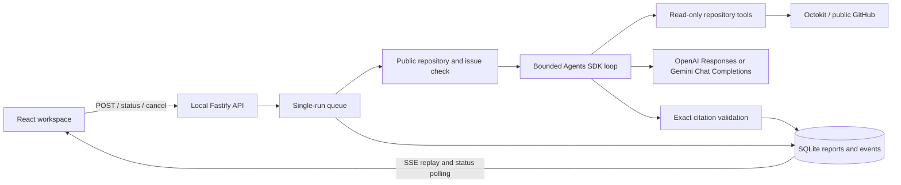

# Architecture and operating boundaries



The application owns the SDK loop; the model chooses tools within a fixed allowlist.
The source repository is never cloned, mounted, or executed. Tool calls only retrieve
issues, source, history, and diffs. Proposed fixes are report text, not patches.
The app writes its own SQLite state and evaluation output, not the investigated repo.

Repository connection verifies public visibility and pins the source commit. Issue
metadata is live; the supplied issue number is checked before any model request.
All retrieved text is untrusted. Citations must match exact lines actually returned
by `read_file` or `read_definition` in that run. Citation validity does not establish causal correctness.
The frontend renders text with React escaping and constructs commit-pinned links.

## How RepoSleuth and the model communicate

RepoSleuth owns the investigation loop. The external model proposes tool calls and
interprets the returned code; it does not access GitHub directly. RepoSleuth sends
instructions, the investigation question, the preflight issue when available, tool
definitions, and compact working context through the selected provider's API.

```mermaid
sequenceDiagram
    actor User
    participant R as RepoSleuth
    participant M as GPT or Gemini
    participant G as GitHub

    User->>R: Repository, optional issue, and question
    R->>G: Check public repository, pin commit, fetch supplied issue
    G-->>R: Revision and issue metadata
    R->>R: Check budget and limits
    R->>M: Instructions, issue, question, and tool definitions

    loop Explore while limits allow
        M-->>R: Structured tool request
        R->>R: Validate arguments and enforce tool limits
        R->>G: Retrieve requested data when not cached
        G-->>R: Repository data
        R->>R: Bound result size; register returned source evidence
        R->>R: Check remaining budget before next model request
        R->>M: Compact task, working notes, evidence and recent tool results
    end

    opt Exploration allowance is nearly exhausted
        R->>M: Disable tools and request a partial report if budget permits
    end
    M-->>R: Structured findings and evidence references
    R->>R: Validate report and resolve citations from returned source
    alt Report and citations are valid
        R-->>User: Saved report, activity, usage, and limitations
    else Output is invalid or investigation fails
        R-->>User: Saved failure diagnostics; no accepted report
    end
```

| Model responsibility | RepoSleuth responsibility |
| --- | --- |
| Choose searches, files, and requested line ranges | Expose allowed tools and validate their arguments |
| Follow code references and propose causes | Retrieve bounded source at the pinned commit |
| Explain findings, uncertainty, proposed fixes, and tests | Validate report structure and source citations |
| Return a structured report | Enforce limits, record usage, and save/display results |

Tool requests and results are structured data carried through API messages. A model
request to `read_file` includes a path and line range. RepoSleuth returns numbered
source lines and a run-scoped `evidenceHandle` only when that source fits the result
allowance. The model cites the handle and a contained line range; the backend builds
the exact quote, path, and commit reference. Search snippets alone cannot be cited.

## How the model discovers a file and line range

The model normally discovers relevant lines during the investigation. It does not
start with the correct source location. This illustrative booking example describes
a possible sequence, not a fixed workflow or a promise that every run follows it:

1. Read the supplied issue about bookings missing near a date-range boundary.
2. Use `list_files` or `search_code` to find an endpoint, then read `Program.cs`.
3. Notice that the endpoint calls `BookingService.Between(...)`.
4. Request `find_files` with `{"query":"BookingService"}` to locate its implementation.
5. Request `read_file` with
   `{"path":"Services/BookingService.cs","startLine":1,"endLine":100}`.
   RepoSleuth returns numbered lines and an evidence handle, such as `read-2`.
6. After inspecting those lines, select the relevant filter for a citation. If it
   were on line 27, an evidence entry could be
   `{"id":"#1","handle":"read-2","startLine":27,"endLine":27}`.
   Findings reference the evidence ID `#1`, not the handle `read-2`.

A search result can also supply a path and line number, allowing a read of nearby
lines directly. A read is limited to 200 lines and may be withheld if its serialized
result exceeds the remaining allowance; the model must then narrow its request.

The model can focus both `find_files` and `search_code` with a repository-relative
directory `scope`. For example, it can request
`{"query":"enabled","scope":"packages/solid-query"}`. RepoSleuth filters to that
directory before applying the search limits; a sibling such as `solid-query-dev`
is excluded. Empty, omitted, or null scope means the repository root. The model
chooses the scope from issue context or discovered paths; RepoSleuth does not pick
a package based on benchmark answers.

Discovery remains bounded: `find_files` matches against all eligible paths in the
cached tree (up to 5,000), filtering by scope and query before returning at most
40 matches. It does not download source blobs. `search_code` indexes at most 40 files / 2 MiB within
that directory. Source-cache and total GitHub request limits remain shared across
scopes; changing directories does not reset those limits. The repository tree is
also bounded, and warnings are retained. A missing result is not proof that a file
or symbol is absent. Narrower scopes and `list_files` prefixes can expose paths
omitted from root results. The model may still follow the wrong path or run out of
budget before reaching the implementation.

Citation validation establishes that quoted source was retrieved, not that the
diagnosis is correct or a proposed fix works. RepoSleuth does not execute proposed
fixes or tests during an investigation; diagnosis quality is evaluated separately.

## Runtime and operating limits

The service runs one investigation at a time and queues up to five. It records
progress and usage in SQLite. The browser reconnects SSE with its event cursor and
polls status every 2.5 seconds as a fallback. Refresh uses the run ID in the URL;
closing a tab does not stop server work. Cancellation/timeout fences prevent late
callbacks from publishing results. Restart marks unfinished work interrupted.

Default model limits: 12 turns, 24 tool calls, 100,000 reported tokens, 2,000 output
tokens/request, 120 seconds, and $0.05 estimated cost/run. Provider limits and input
estimation are described in the README. Before model calls, a persistent ledger
reserves a conservative bound. Reservations are not refunded and are not invoices.
Incomplete usage remains labeled. Model retries are disabled; GitHub rate-limit
failures are surfaced without automatic retries. A user may explicitly start a new
run after addressing the cause; it has a new budget reservation.

Development uses Vite on loopback:5173 with a proxy to Fastify on loopback:3001.
Production serves only the built web directory alongside the API. Host/Origin
checks remain in force. Docker binds internally on 0.0.0.0 but Compose publishes
only 127.0.0.1:5174. It runs as a non-root user with a read-only root filesystem,
no Linux capabilities, a writable data volume, and a small temporary filesystem.
There is no remote authentication; do not expose this local service publicly.

`DEMO_ONLY=1` disables live investigations even if credentials are present. The
default Docker image enables it. The live Compose override explicitly disables it
and passes secrets only at runtime. `.dockerignore` excludes all environment files,
SQLite databases, logs, and local dependencies from the build context. No repository
write, shell, PR, Kubernetes, vector database, or multi-agent tool is available.

The replay evaluator uses the same service, SDK, tools, storage, budgets, and
validator with synthetic repositories and scripted model responses. It measures
pipeline correctness. Optional live evaluation uses only fixture source/questions;
expected root causes are kept in the evaluator, outside the model context.

### Navigation recovery

`list_files` accepts an offset and returns `nextOffset` when more paths remain. Pages shrink to the current tool-output allowance; continuation stays within the pinned, bounded tree. Truncation warnings remain visible even when no further cached paths exist. `read_file` range errors return a safe reason and the 200-line request limit; a start beyond EOF also returns the file length. Valid reads already clamp their end to EOF. Tool-start events record the requested path and line range, while failed reads never register evidence handles. These recovery hints do not expand investigation budgets or relax citation validation.

Source responses deliver a bounded window within the current serialized UTF-8 byte allowance (including evidence metadata), with continuation metadata when more source remains. Only delivered source registers evidence. If one line cannot fit, the response directs the model to another relevant range. Malformed report diagnostics retain only safe numeric parser information or bounded schema field paths, never the parser message or rejected source content. A normal provider stop reason does not bypass JSON validation.

An invalid JSON/report structure can trigger at most one tool-free model correction. The same budget-enforcing model admits and charges this request against existing request, token, time, run-cost and persistent-cost limits; correction has no additional allowance. Oversized rejected responses skip correction. The replacement must pass report-schema validation and the ordinary strict evidence validation. Invalid citations do not trigger correction. Activity events distinguish a requested correction, a schema-valid response awaiting evidence validation, and failure; a schema-valid response alone is not an accepted report.

Working context retains requested but unread source ranges independently of the recent tool journal. Delivered reads subtract only their actual intervals, preserving internal gaps. `read_definition` can focus on a unique call inside a large implementation; ambiguous or absent matches return navigation information without an evidence handle. Unexamined parts of a focused definition remain visible as coverage gaps. Remaining ranges mark the final report partial and appear in its unanswered questions; they are not evidence of a defect.

### Exploration budget diagnostics

Each model turn records a content-free `budget_plan`: current and final input estimates, combined planned token/cost allowance, per-constraint tool-output capacities, and the reporting reason. Unlimited lifetime headroom is represented as null. These are planning estimates, not billed costs; request admission and all hard limits remain unchanged. A repeated `get_issue` for the supplied preflight issue returns a short pointer to the original input instead of duplicating the issue/comments. Related issue numbers still use normal repository retrieval. The attempted tool call still consumes its normal allowance.

Evidence materialization failures retain the existing `INVALID_LINE_RANGE` rejection code, with a safe diagnostic distinguishing reversed ranges, ranges outside the referenced read, missing lines, empty quotes, and quotes above the 4,000-character limit. Known handles supply a backend read index and requested/available numeric ranges; quote failures include character counts. Unknown handles do not imply an available range. Rejected text, IDs, handles, and source are not included in these diagnostics. Validation does not repair or accept the rejected report.

### Citation fidelity versus claim support

A completed report has passed structural and source-fidelity checks, not proof of diagnosis correctness. An exact import citation can support an import fact but cannot establish another function’s runtime behavior. Investigator instructions require issue-reported mechanisms to stay attributed and unverified until behavioral evidence supports them. The benchmark judge assesses each claim against its own cited lines rather than borrowing support from the private answer. The incidental-import offline fixture verifies that a correct cause plus a real but irrelevant quote stays unscored without a judge and fails when the supplied semantic judgment marks relevance as unsupported. These scripted judgments test grading behavior, not live-model reasoning; no deterministic import blacklist is introduced.


## Integrated investigation context

The SDK retains its conversation internally, but each provider request receives a self-contained untrusted-data snapshot before completion planning and hard admission. The snapshot includes the original task/issue, up to three model-authored hypotheses and six unresolved paths, a catalog of every successful source read, up to 18 KB of exact source (prioritizing pinned handles), and the last four tool outcomes. Older discovery payloads above 2,200 bytes are explicitly omitted; the latest result is retained within the tool output limit. Original source reads remain immutable for final citation validation even if absent from the current context. Re-reading may be required. Model notes are never promoted to facts or system instructions. No summary model or extra paid call is used.

`outline_file` parses TS/JS/TSX declarations, imports, and call sites with the TypeScript parser. Query filtering happens before the 80-definition/80-call-site caps. Relative import candidates are restricted to actual eligible tree paths; aliases and external packages are not resolved. A call site is not a resolved reference. C# uses labeled lexical line anchors; other languages fall back to existing bounded search and reads. The parser never executes repository code.

`read_definition` prefers executable TS/JS bodies over overload declarations in the same lexical scope. An explicitly selected overload redirects to its unique implementation; duplicate implementations still require disambiguation. Named function expressions, getters/setters and statically named function properties are included. This is syntax navigation, not semantic resolution.

Both source-reading tools share bounded-window delivery: at most 200 lines, 4,000 quote characters and the current output allowance. Oversized requests return a fitting prefix and `nextStartLine`, rather than withholding the entire read. Provider output-limit recovery halves the range within the same tool call; other failures remain errors. Single lines that cannot fit produce no handle. Source calls serialize handle registration so concurrent calls cannot share an evidence handle. Existing request, cache, source-size, output and cost limits still apply.

Draft citations may select a whole delivered window by supplying a handle and null line bounds, or select a narrower explicit range. The backend resolves the exact bounds and quote. Partial bounds, unknown handles, unseen lines, oversized quotes and dangling finding references remain invalid; no malformed report is silently repaired or accepted.

Report verification metadata is built by the backend: source-citation fidelity, coverage, files/ranges examined, diagnosis unverified and runtime not executed. It is excluded from the model output schema. The UI and Markdown export show these distinctions; old reports remain readable without inventing verification details.

The reliability additions in `evaluation/reliability` include four synthetic cases and an offline paired-results comparison. Run `npm run eval:compare -- path/to/observations.json`. The checker rejects missing pairs, duplicate attempts and mismatched input/settings hashes. It does not assert the supplied semantic assessments are true or certify that all planned cases/repetitions were run. See [milestone and campaign gates](investigation-reliability.md).
